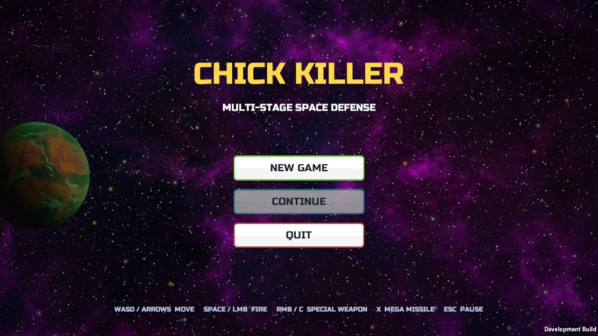
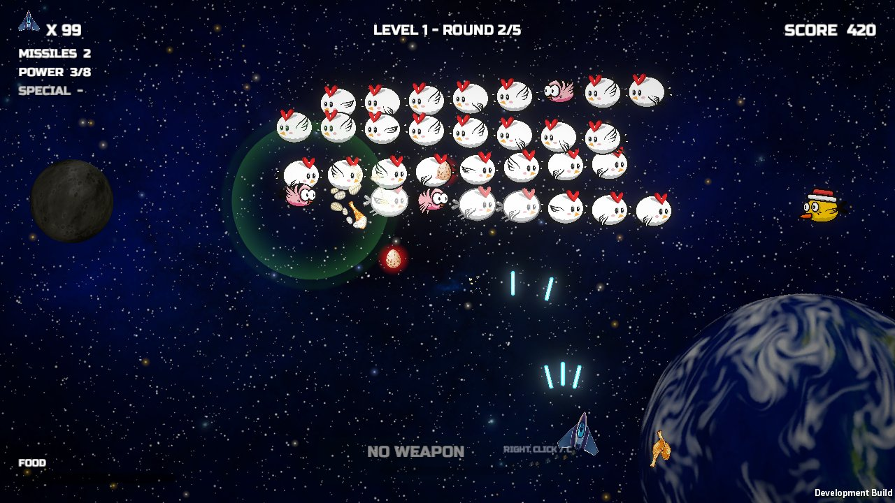
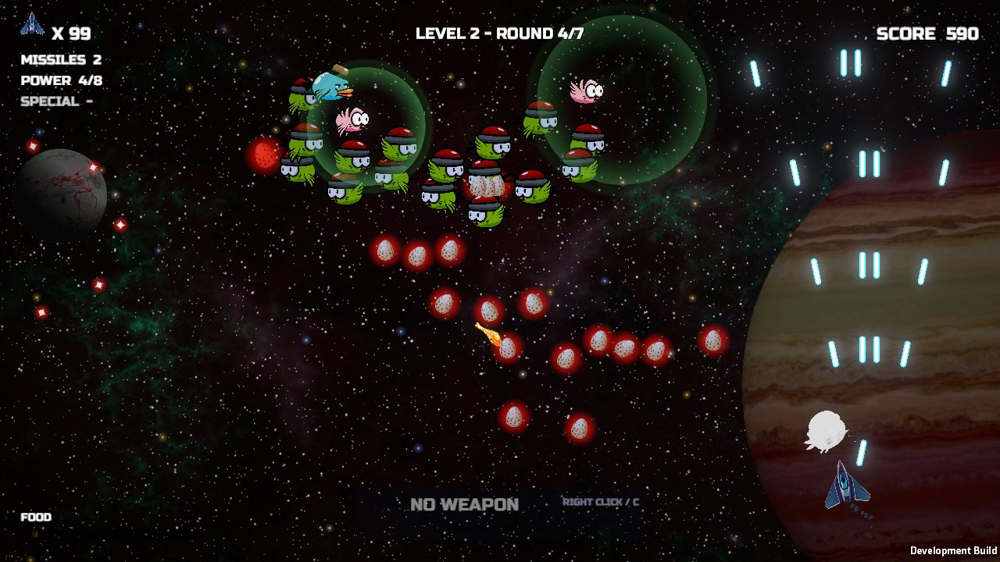
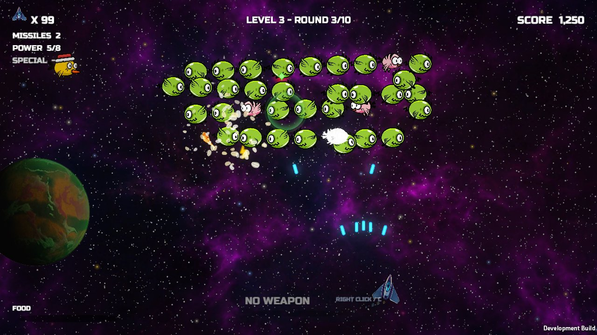
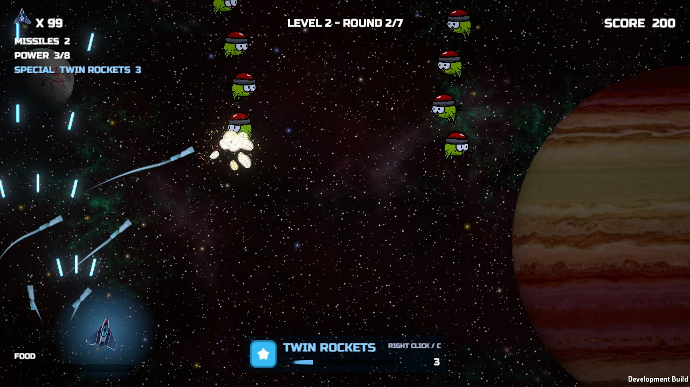
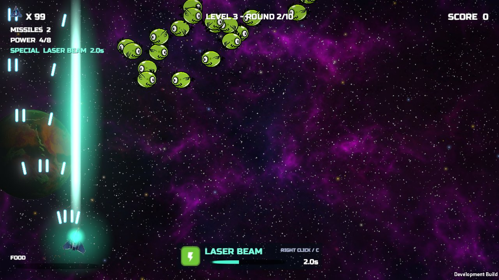
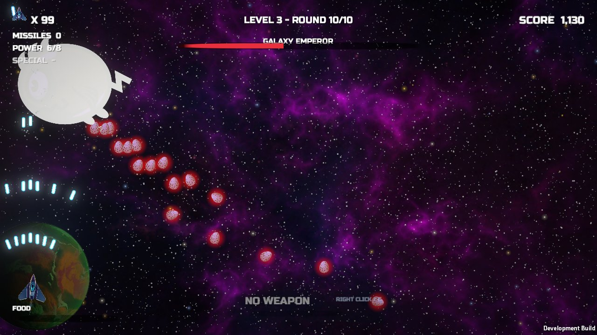

# 🐔 Chick Killer

A top-down space shooter in the spirit of the classic chicken-invader arcade games, built with **Unity 6 (6000.6) + URP 2D**.
Fly a starfighter through three hand-themed levels, shred flocks of space chickens with eight power levels of lasers,
grab one-at-a-time special weapons, and take down three bosses — the last of which has a very long name.

> Homework 3 — Game Design course, Iran University of Science and Technology.



## Features

- **3 levels / 22 rounds** — Earth Orbit (5 rounds), Asteroid Belt & Jupiter (7), Deep Galaxy (10), each with its own
  nebula, realistic generated star field and drifting planets (parallax).
- **8 laser power levels** — collect power-ups to go from a single bolt to a wide multi-beam spread.
- **Shield rule** — a hit costs one power level; only a hit at power 1 costs a life. You respawn at power 3.
- **5 special weapons** (one at a time, a new crate replaces the old one): Twin Rockets, Bee Minigun, Laser Beam,
  Flak Cannon, Saw Launcher.
- **Different enemies with different behaviour** — formation chickens plus rogue birds: stingers, bombers, gunner ducks,
  diving minions, armoured, reviving and healing chickens, each with its own projectiles.
- **3 bosses driven by a finite-state machine** (State pattern, multiple phases):
  - **Big Chick** — level 1
  - **Colah Gherrmezi Chick** — level 2
  - **Invincible, Fearless, Sensual, Mysterious, Enchanting, Vigorous, Diligent, Overwhelming, Gorgeous, Passionate,
    Terrifying, Beautiful, Powerful, Green Emperor Chick** — level 3 (he insists on the full title)
- Missiles (screen-clearing bomb), food pickups for score, hit-stop, screen shake, selective bloom, flash shader.

| | | |
|---|---|---|
|  |  |  |
|  |  |  |

## Controls

| Action | Keyboard / Mouse | Gamepad |
|---|---|---|
| Move | WASD / Arrow keys | Left stick |
| Fire | Space / Left click | A |
| Special weapon | Right click / C | Right trigger |
| Missile (bomb) | X | B |
| Pause | Esc / P | Start |

## Running

1. Install **Unity 6000.6.7f1** (Unity 6.6) via Unity Hub.
2. Open this folder as a project.
3. Open `Assets/_Project/Scenes/MainMenu.unity` and press Play,
   or build with **Tools → Chick Killer → Build Windows (Release)** (output: `Builds/Windows/ChickKiller.exe`).

The game starts in borderless fullscreen.

## Architecture

- **Data-driven** — levels, rounds, waves, enemies, weapons, special weapons, bosses and entry paths are
  ScriptableObjects (`LevelDataSO`, `WaveDataSO`, `EnemyDataSO`, `WeaponDataSO`, `SpecialWeaponSO`, `BossProfileSO`, …).
- **Content builder** — `Assets/_Project/Scripts/Editor/GameContentBuilder.cs` generates every prefab, ScriptableObject
  and scene. It is the source of truth: change it and run **Tools → Chick Killer → Build Game Content**.
- **Patterns** — GameManager singleton, static `GameEvents` event bus, object pooling (`PoolManager`),
  Strategy (wave runners, special weapons), State (boss FSM), component-based enemy abilities.
- **Tooling** — `DevAutopilot` (development builds only) plays the game from the command line, takes screenshots and
  logs events; `Tools/generate_star_layers.py` generates the star layers.

```
Assets/_Project/
  Scripts/  Core · Player · Combat · Enemies · Waves · Levels · Pooling · UI · Data · Editor
  Data/     generated ScriptableObjects
  Prefabs/  generated prefabs
  Scenes/   MainMenu, Level1–3
  Shaders/  SpriteFlash
```

## Credits

All third-party art, music and fonts are CC0 or SIL OFL — see [CREDITS.md](CREDITS.md).
